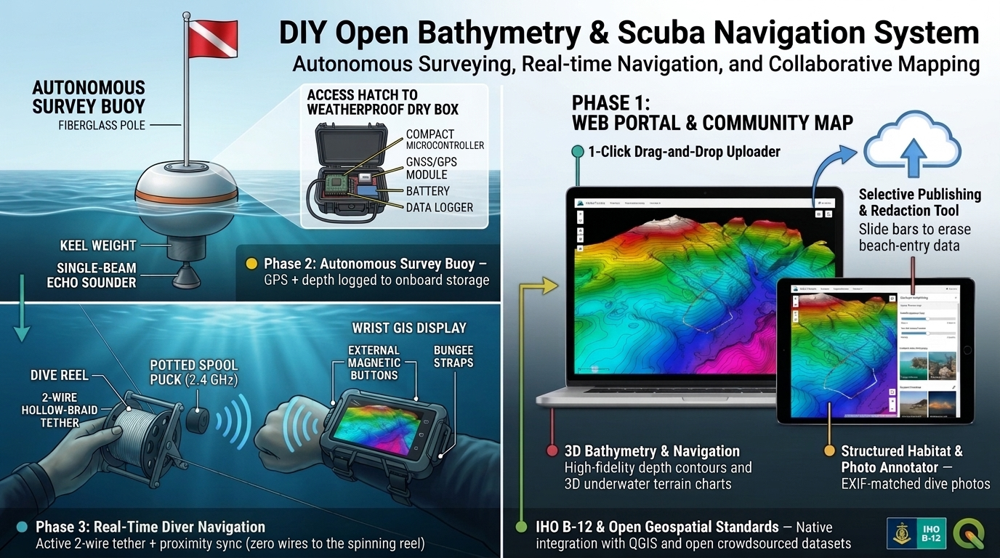
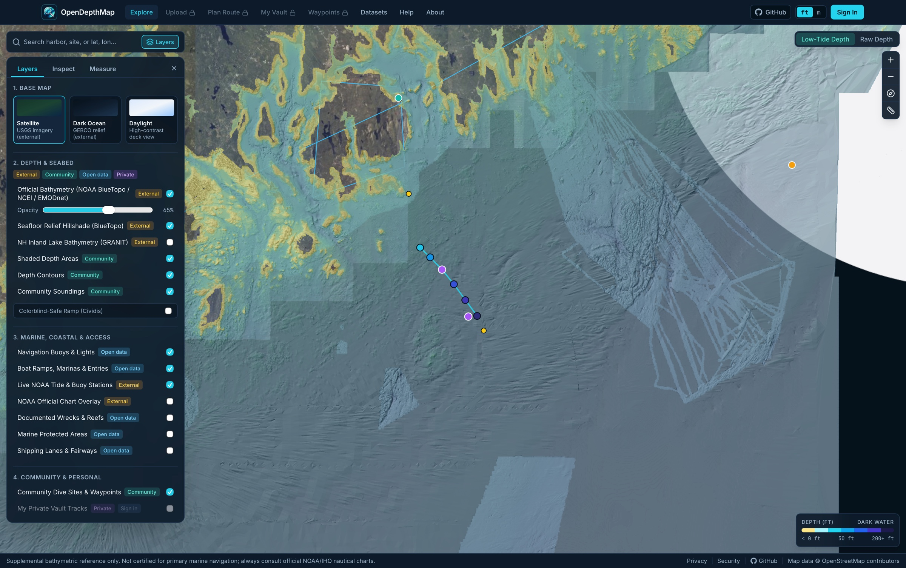

# OpenDepthMap

Open standards, open hardware, and a web portal for community bathymetry: vendor-neutral sonar ingestion, official and community depth layers with explicit vertical datums, and low-cost subsea situational awareness for divers, boaters, makers, and marine scientists.

[Docs & User Guide](https://github.com/opendepthmap/docs) · [Report Alpha Issues](https://github.com/opendepthmap/docs/issues/new/choose) · [Protocols & Schemas](https://github.com/opendepthmap/protocols) · [Open Hardware](https://github.com/opendepthmap/hardware) · [GitHub Discussions](https://github.com/orgs/opendepthmap/discussions) · [Get Involved](#how-to-get-involved-right-now)

### System Overview

*Surface survey buoy, tethered spool puck, and diver receiver working together with the web portal.*

### Web Portal Preview

*The Explore view of the web portal (in development), combining official, open-data, and community bathymetry layers.*

## Why This Project Exists

- **Nearshore White-Ribbon Bathymetry:** Official hydrographic vessels draw too much draft to safely map shallow rocky coastlines, intertidal reefs, and kelp beds (under 10-15 meters), satellite-derived bathymetry fails in dark or turbid coastal waters, and millions of inland lakes, quarries, and reservoirs remain uncharted. OpenDepthMap uses surface micro-buoys and frequent community resurveys to close the nearshore "white ribbon" gap and track erosion, sediment deposition, dredging, and post-storm shifts over time.
- **Vendor-Neutral Sonar Ingestion:** Recreational boaters, anglers, and divers capture high-resolution depth data every day that stays locked inside closed manufacturer formats. OpenDepthMap brings vendor-neutral ingestion into open geospatial standards (OGC API - Features, IHO B-12 CSB, GeoParquet) with explicit vertical datum labeling (never mixing unreduced raw transducer depth with tide-reduced chart datums) and privacy-by-default controls.
- **Low-Cost Subsea Situational Awareness:** Commercial hydrographic survey gear and USBL underwater positioning systems cost tens of thousands of dollars, while analog magnetic compasses are disrupted by wrecks, reinforced concrete, steel cylinders, cross-currents, and low visibility. OpenDepthMap brings open-source surface-tethered positioning, bathymetric logging, and diver-verified substrate, ecological, and hazard mapping within standard DIY maker budgets.

For the full problem statement and six-gap breakdown, see [OpenDepthMap Public Intent](https://github.com/opendepthmap/protocols/blob/main/docs/intent.md).

## Built For

- **Recreational Scuba Divers & Foragers:** Offline dark-water depth charts, gloved magnetic-button hardware controls, locked return bearings, and privacy-by-default protection for sensitive reefs and shoreline entries.
- **Coastal Boaters, Anglers & Small-Craft Operators:** Explicit vertical datum labeling (never mixing unreduced raw transducer depth with tide-reduced chart datums), shoal hazard visibility, and open sonar log importing.
- **DIY Hardware Makers & Tinkerers:** Open-source surface survey buoy and diver receiver designs, accessible bills of materials, waterproofing guidance, and local browser-based device setup.
- **GIS Engineers & Marine Scientists:** Reproducible geospatial standards, quality-control flags, uncertainty grading, standardized marine taxonomy metadata, and open exports (OGC API - Features, IHO B-12 CSB, GeoParquet, CF-NetCDF, COG, and PMTiles).

## Roadmap Overview

| Phase | Focus | Status |
| :--- | :--- | :--- |
| **Phase 1** | Core Web Portal, Open Schemas & Cloud Processing Platform | In Development |
| **Phase 2** | Open-Source Autonomous Surface Survey Buoy (CAD & Firmware) | Planned |
| **Phase 3** | Tethered Spool Puck (reel-mounted hub relaying surface GPS down a dive line) & Diver Hand/Wrist Receiver | Planned |

## Public Repositories

- **[opendepthmap/docs](https://github.com/opendepthmap/docs):** Public User Guide, Engineering & CI Test-Gate Transparency docs, Changelog, and Early Alpha bug/feature issue tracker (`CC0-1.0`).
- **[opendepthmap/protocols](https://github.com/opendepthmap/protocols):** Public data schemas, wire protocols, external API specifications, and sanitized sample fixtures (`CC0-1.0` / `MIT`).
- **[opendepthmap/hardware](https://github.com/opendepthmap/hardware):** Open-source hardware designs, CAD/STL files, bills of materials, and embedded firmware for Phase 2 and Phase 3 units (`CERN-OHL-P v2` / `MIT`).

## How to Get Involved Right Now

- **Report Early Alpha Bugs & Ideas in [opendepthmap/docs](https://github.com/opendepthmap/docs/issues/new/choose):** File structured bug reports, sonar format requests, or UI/UX feedback using the issue forms.
- **Join the Conversation on [GitHub Discussions](https://github.com/orgs/opendepthmap/discussions):** Introduce your boat, dive, or maker setup, ask questions about vertical datums or hardware builds, and share regional mapping needs.
- **Submit [Sample Sonar Logs](https://github.com/opendepthmap/protocols/issues/new):** Share sanitized GPX, CSV, GeoJSON, NMEA 0183/2000, WIBL / IHO B-12, or chartplotter exports to expand our public [synthetic and sample test fixtures](https://github.com/opendepthmap/protocols/tree/main/docs/samples) and harden vendor-neutral parsers.
- **Review & Propose Architecture RFCs:** Comment on open schema and API proposals in [opendepthmap/protocols](https://github.com/opendepthmap/protocols/issues) or help shape Phase 2/3 hardware ADRs in [opendepthmap/hardware/docs/adr](https://github.com/opendepthmap/hardware/tree/main/docs/adr).

## Current Status

OpenDepthMap is in **Early Alpha** (`v0.1.0-alpha`). The Phase 1 web portal (ingestion, privacy controls, hydrographic QC, route planning, open exports, and the Explore map) is in active early testing ahead of broad human field-testing, while the portal source remains closed. Public documentation, CI test-gate transparency notes, open schemas, reference fixtures, and hardware baselines live in the public repositories above.

## Attribution & Non-Navigational Disclaimer

Base map land and shoreline data derived from OpenStreetMap is used under ODbL 1.0 ([Map data © OpenStreetMap contributors](https://www.openstreetmap.org/copyright)).

> **Important:** Supplemental bathymetric reference only. Not certified for primary marine navigation; always consult official NOAA/IHO nautical charts. Hardware receivers are supplemental situational awareness tools and never replace a primary dive computer, analog backup compass, or physical reel guideline.
